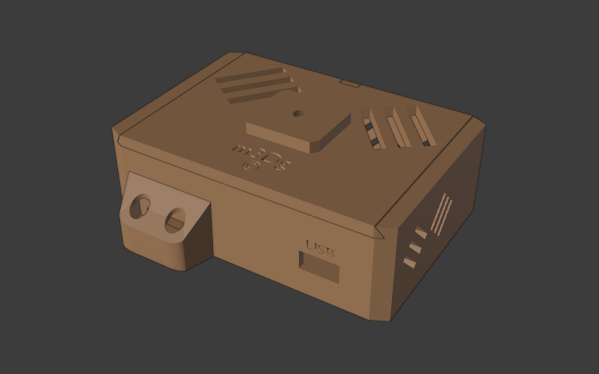
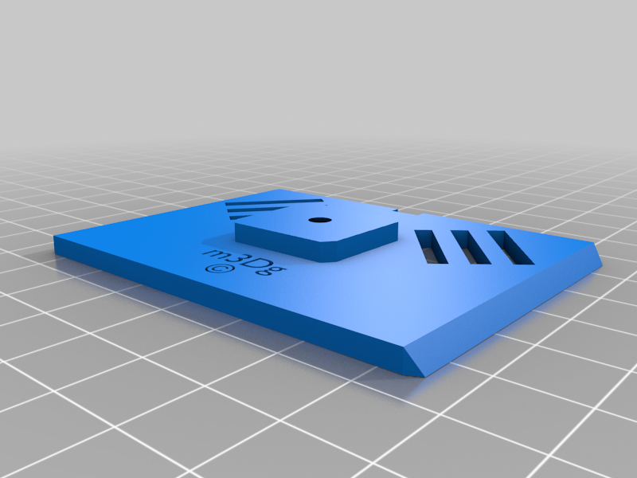
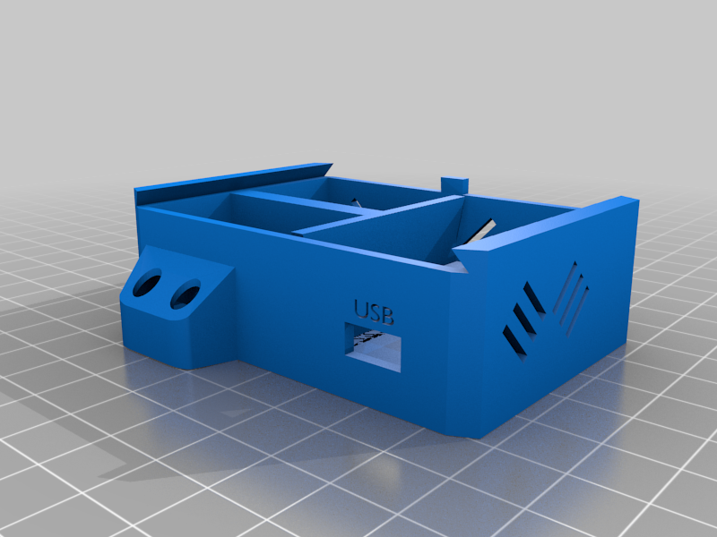

# MQ-2 Gas Detection System | Arduino Nano

A beginner-friendly gas and smoke detection project built using an MQ-2 metal-oxide gas sensor, Arduino Nano, and a buzzer.


## Project Demonstration

Watch the hardware setup and sensor testing demonstration of the MQ-2 Gas Sensor project.

[](https://youtu.be/XV0bhmBA-qs)

▶ [Watch the full demonstration on YouTube](https://youtu.be/XV0bhmBA-qs)


This project introduces the fundamentals of gas sensing, analog signal measurement, sensor calibration, resistance measurement, and embedded alarm systems.

The goal is not only to build a working gas detector, but also to understand how a low-cost sensor behaves, why calibration matters, and what is required to develop a reliable industrial sensing instrument.

> **Important:** This is an educational prototype. It is not a certified gas detector and must not be used as a replacement for industrial, residential, or life-safety gas detection equipment.
>


---

## Project Overview

| Component | Description | Purchase Link | Listed Price |
|---|---|---|---|
| Microcontroller | Arduino Nano (ATmega328P, 5V) | [Buy Arduino Nano R3](https://store.roboticsbd.com/development-boards/926-arduino-nano-r3-robotics-bangladesh.html) | Approx. BDT 600* |
| Gas Sensor | MQ-2 Smoke and Gas Sensor Module | [Buy MQ-2 Sensor](https://store.roboticsbd.com/sensors/671-mq-2-flammable-gas-smoke-sensor-robotics-bangladesh.html) | Check current price |
| Analog Input | MQ-2 AO → A2 | — | — |
| Digital Output | MQ-2 DO → D2 (if using a module with DO pin) | — | — |
| Buzzer | 5V Active Buzzer Module → D8 | [Buy Active Buzzer](https://store.roboticsbd.com/sensors/1738-active-speaker-buzzer-module-for-arduino-5v-robotics-bangladesh.html) | Approx. BDT 80* |
| Load Resistor | 10 kΩ (required for bare sensor circuit; module may already include it) | [Buy 10 kΩ Resistors](https://store.roboticsbd.com/resistor/243-10k-ohm-carbon-film-resistor-pack-of-10-robotics-bangladesh.html) | Check current price |
| Operating Voltage | 5V | — | — |
| Power Source | Laptop USB, suitable USB power bank, or compatible 5V phone charger | — | — |
| Programming Environment | Arduino IDE | [Download Arduino IDE](https://www.arduino.cc/en/software) | Free |

\*Prices are indicative and may change. Check the product page for the current price, stock availability, delivery charge, and final checkout total.


### What this project does

- Reads the MQ-2 sensor's analog output.
- Converts the analog signal into a numerical ADC value.
- Uses a configurable threshold to detect an elevated sensor response.
- Activates a buzzer when the threshold is exceeded.
- Allows users to observe sensor behavior through the Serial Monitor.
- Introduces the process of sensor warm-up, baseline measurement, and calibration.


## 1. Hardware and Circuit Design

### Required components

- Arduino Nano
- MQ-2 gas sensor
- 10 kΩ resistor
- Active buzzer or suitable buzzer module
- Breadboard
- Jumper wires
- USB data cable
- Laptop or USB power bank

### Circuit connections

| MQ-2 / Component | Arduino Nano |
|---|---|
| Sensor analog output | A2 |
| Sensor heater supply | 5V |
| Sensor heater ground | GND |
| Load resistor | 10 kΩ from A2 output node to GND |
| Buzzer positive / signal | D8 |
| Buzzer negative | GND |

The MQ-2 sensing circuit is based on a resistive divider. The sensor resistance changes when exposed to different gases, which changes the voltage measured by the Arduino.

### Wiring diagram


The basic sensing circuit uses:

- A 5 V supply for the sensor circuit and heater.
- A load resistor connected between the analog output node and ground.
- A2 to measure the voltage at the output node.

The sensor's heater pins and sensing electrodes are separate electrical elements. Make sure the correct pins are identified from the datasheet or the pin diagram before wiring the bare sensor.

For a bare six-pin MQ-2, the two heater pins must be connected to the heater supply, while the sensing electrodes are connected as a resistive measurement circuit.

The uploaded circuit diagram illustrates the basic analog sensing arrangement.


### 3D-Printed Enclosure Design

To make the project more organized and practical, I designed a custom 3D-printed casing for the MQ-2 gas detection system.

The enclosure provides a compact structure for mounting the Arduino Nano, MQ-2 sensor, buzzer, and circuit connections. It also helps keep the electronic components arranged properly and makes the prototype easier to handle during demonstrations and testing.

The casing was designed with the sensor's placement in mind, allowing the MQ-2 sensing element to remain exposed to the surrounding air for gas detection.

The 3D model files are included in this repository, so students and makers can inspect the design, modify it, or print their own enclosure.

**Design and fabrication**

- Custom 3D-printed enclosure
- Organized mounting for electronic components
- Dedicated placement for the MQ-2 sensor
- Compact and practical prototype structure
- Editable 3D model files included in the repository

The following images show the enclosure design and the assembled prototype.

### 3D-Printed Enclosure Design

The enclosure was designed to provide a compact and organized structure for the MQ-2 gas detection system. The 3D-printed casing holds the electronic components while keeping the sensing element exposed to the surrounding air.

The design files and images are available in the repository for students and makers who want to inspect, modify, or reproduce the enclosure.

#### Enclosure Design and 3D Model

<table>
  <tr>
    <td align="center" width="33%">
      
      <br/>
      <sub>3D Enclosure Model</sub>
    </td>
    <td align="center" width="33%">
      
      <br/>
      <sub>Enclosure Cover</sub>
    </td>
    <td align="center" width="33%">
      
      <br/>
      <sub>Enclosure Design Detail</sub>
    </td>
  </tr>
</table>

**Explore the complete design files:** [Smoke Detection System 3D File](https://github.com/Rifat-Ahmed-569/Mq2-/tree/main/Smoke%20Detection%20System%203D%20File)


## 3D Printer Operating Guide

Follow the video tutorial below for a visual guide to operating a 3D printer.

### Video Tutorial

[](https://www.youtube.com/watch?v=B84CgaPdixc)

[**Watch the 3D Printer Operating Guide on YouTube**](https://www.youtube.com/watch?v=B84CgaPdixc)

### Basic Operating Procedure

#### Step 1 — Prepare the 3D Model

- Open your 3D model in a slicer software such as Ultimaker Cura or PrusaSlicer.
- Select the correct printer profile.
- Configure the printing material, layer height, infill, and support settings.
- Slice the model and preview the generated layers.
- Export the sliced file as G-code.

#### Step 2 — Prepare the Printer

- Place the printer on a stable, level surface.
- Check that the build plate is clean.
- Ensure the nozzle and build plate are free from leftover filament.
- Check that the filament is properly loaded.
- Confirm that the printer's power cable and connections are secure.

#### Step 3 — Start the Print

- Transfer the G-code file to the printer using the supported method, such as an SD card or USB connection.
- Select the correct file from the printer's interface.
- Start the printing process.
- Observe the first few layers to ensure proper bed adhesion.

#### Step 4 — Monitor the Printing Process

- Check that the filament is feeding smoothly.
- Ensure the printed layers are sticking properly to the build plate.
- Watch for filament tangles, unusual noises, or printing errors.
- Do not leave the printer unattended for extended periods, especially during initial testing.

#### Step 5 — Remove the Printed Part

- Wait until the print and build plate have cooled sufficiently.
- Carefully remove the printed object using an appropriate tool.
- Avoid touching the hot nozzle or heated bed.
- Clean the build plate and remove any leftover filament.

### Safety Precautions

- Never touch the nozzle or heated bed while they are hot.
- Keep hands, loose clothing, and cables away from moving parts.
- Operate the printer in a well-ventilated area.
- Use the correct temperature settings for the selected filament.
- Do not force the printed object off the build plate.
- Follow the operating instructions provided by the printer manufacturer.

**Note:** The exact operating procedure may vary depending on the 3D printer model. Always follow the manufacturer's instructions for bed leveling, filament loading, temperature settings, and maintenance.


---

## 2. How the MQ-2 Sensor Works

The MQ-2 is a metal-oxide semiconductor (MOS) gas sensor.


Watch this video: https://www.instagram.com/reels/DgEQjaYBwyr/


Its sensing material is primarily **tin dioxide (SnO₂)**, a semiconductor whose electrical resistance changes depending on the surrounding gas environment.

The sensor contains several important internal parts:

| Internal part | Function |
|---|---|
| SnO₂ sensing layer | Changes electrical resistance in response to gases |
| Ceramic substrate | Supports the sensing structure |
| Heater coil | Maintains the required operating temperature |
| Measuring electrodes | Measure the sensing layer's resistance |
| Metal mesh | Protects the sensing element while allowing gas diffusion |

The heater is essential. The sensing material does not operate correctly at ordinary room temperature.

When the sensor is heated, gas molecules interact with the sensing surface. This changes the electrical properties of the semiconductor.

For the MQ-2, resistance generally decreases when exposed to many combustible gases and smoke-related compounds.

However, the sensor is not selective to a single gas. It can respond to LPG, propane, hydrogen, methane, smoke, alcohol vapors, and other substances.

This is why the MQ-2 is useful for learning gas detection, but unsuitable for precise identification of a specific gas without additional measurement and calibration methods.

---

## 3. Understanding the Analog Signal

The MQ-2 sensor is connected to a load resistor, forming a voltage divider.

The output voltage is:

\[
V_{out}=V_C\frac{R_L}{R_S+R_L}
\]

Where:

- \(V_C\) = circuit supply voltage
- \(R_L\) = load resistance
- \(R_S\) = sensor resistance

The sensor resistance can be calculated from the measured voltage:

\[
R_S=R_L\left(\frac{V_C}{V_{out}}-1\right)
\]

For this project:

- \(V_C\) is approximately 5 V.
- \(R_L\) is 10 kΩ.
- \(V_{out}\) is measured using Arduino Nano A2.

The Arduino Nano's 10-bit ADC converts the analog voltage into a value between 0 and 1023.

At a 5 V ADC reference:

\[
V_{out}\approx\frac{ADC}{1023}\times5
\]

This is the fundamental measurement process behind the project.

---

## 4. Analog and Digital Detection

This project uses the same A2 pin for analog measurement and software-based digital detection.

The analog reading provides a continuous numerical measurement.

The digital detection logic compares the analog value with a configured threshold:

```cpp
if (sensorValue > threshold) {
    // Gas response exceeds the configured threshold
}
```

This is a software threshold, not a separate digital sensor output.

A commercial MQ-2 module may also include an LM393 comparator and a separate digital output pin. That output is adjusted using a potentiometer and provides a simple HIGH/LOW signal.

The bare MQ-2 sensor does not contain this comparator circuit.

---

## 5. Arduino IDE: From Download to Upload

This project is designed for students who have never programmed an Arduino before.


### Step 1 — Download Arduino IDE

Download Arduino IDE from the official website:

https://www.arduino.cc/en/software

Install the software for your operating system.

### Step 2 — Connect the Arduino Nano

Connect the Arduino Nano to your laptop using a USB data cable.

A charge-only cable may power the board but will not allow programming.

### Step 3 — Open Arduino IDE

Launch Arduino IDE.

Create a new sketch:

**File → New Sketch**

### Step 4 — Select the Arduino board

Go to:

**Tools → Board → Arduino AVR Boards → Arduino Nano**

If the Arduino AVR board package is not installed, open Boards Manager and install it.

### Step 5 — Select the processor

For many classic Arduino Nano boards, select:

**Tools → Processor → ATmega328P**

If uploading fails, try:

**ATmega328P (Old Bootloader)**

Some Nano-compatible boards use a different bootloader.

### Step 6 — Select the USB port

Go to:

**Tools → Port**

Select the port associated with your Arduino Nano.

On Windows, it may appear as COM3, COM4, COM5, or another COM port.

### Step 7 — Upload the program

Here is the basic Arduino code for the MQ-2 Smoke Detection System.

Copy and paste the code into the Arduino IDE.

#### Arduino Code

```cpp
// MQ-2 Smoke Detection System
// Arduino Nano

// Pin Configuration
const int MQ2_ANALOG_PIN = A2;
const int MQ2_DIGITAL_PIN = 2;
const int BUZZER_PIN = 8;

// Analog threshold (adjust after testing)
const int GAS_THRESHOLD = 400;

// Set true if the module's D0 output becomes LOW
// when gas or smoke is detected.
const bool DIGITAL_ACTIVE_LOW = true;

void setup() {
  Serial.begin(9600);

  pinMode(MQ2_DIGITAL_PIN, INPUT);
  pinMode(BUZZER_PIN, OUTPUT);

  digitalWrite(BUZZER_PIN, LOW);

  Serial.println("MQ-2 Smoke Detection System");
  Serial.println("Sensor is warming up...");
}

void loop() {
  // Read analog and digital sensor outputs
  int analogValue = analogRead(MQ2_ANALOG_PIN);
  int digitalValue = digitalRead(MQ2_DIGITAL_PIN);

  // Convert digital output into detection status
  bool digitalDetected;

  if (DIGITAL_ACTIVE_LOW) {
    digitalDetected = (digitalValue == LOW);
  } else {
    digitalDetected = (digitalValue == HIGH);
  }

  // Analog threshold detection
  bool analogDetected = (analogValue >= GAS_THRESHOLD);

  // Trigger alarm if either output detects gas/smoke
  bool gasDetected = analogDetected || digitalDetected;

  // Display sensor readings
  Serial.print("Analog Value: ");
  Serial.print(analogValue);

  Serial.print(" | Digital Value: ");
  Serial.print(digitalValue);

  if (gasDetected) {
    digitalWrite(BUZZER_PIN, HIGH);
    Serial.println(" | WARNING: Gas/Smoke Detected!");
  } else {
    digitalWrite(BUZZER_PIN, LOW);
    Serial.println(" | Air Level: Normal");
  }

  delay(500);
}
```

#### Basic Algorithm

1. Initialize the analog sensor, digital sensor, buzzer, and Serial Monitor.
2. Read the MQ-2 analog value from A2.
3. Read the MQ-2 digital output from D2.
4. Compare the analog value with the configured threshold.
5. Check the digital output for gas/smoke detection.
6. If either output indicates detection, activate the buzzer.
7. Otherwise, keep the buzzer turned off.
8. Display the sensor readings and status in the Serial Monitor.
9. Repeat the process continuously.


Also a bit advanced algo:

```cpp

/*
  MQ-2 Gas Detection System
  Board: Arduino Nano (ATmega328P)
  Sensor analog output: A2
  Buzzer signal: D8

  Educational prototype only. NOT a certified gas detector.
  Do not use this project for life-safety or industrial protection.

  Circuit assumed by the resistance equation:
    VCC (Vc) -> MQ-2 sensing element Rs -> A2 / divider node -> RL (10 kOhm) -> GND
  This arrangement makes ADC/Vout rise as Rs falls in response to many combustible gases.
  Check your module's schematic: some MQ-2 breakout boards have different circuitry,
  and their AO pin may not match this bare-sensor divider model.
*/

#include <Arduino.h>

// ----------------------- Hardware configuration -----------------------
const uint8_t SENSOR_PIN = A2;
const uint8_t BUZZER_PIN = 8;

// ----------------------- Measurement parameters ----------------------
const float ADC_REFERENCE_VOLTAGE = 5.00; // ADC reference voltage in volts (measure Vcc for better accuracy)
const uint16_t ADC_MAX_COUNT = 1023;      // 10-bit ADC: 0..1023
const float CIRCUIT_VOLTAGE = 5.00;      // Vc: voltage supplied to the sensor divider
const float LOAD_RESISTANCE_OHMS = 10000.0; // RL: load resistor in ohms

// ----------------------- Detection parameters ------------------------
// Alarm is based on ADC increase from the measured baseline.
// Adjust after observing the sensor in a stable, known safe environment.
const uint16_t ALARM_DELTA_ADC = 80;      // Trigger at baseline ADC + this amount
const uint16_t HYSTERESIS_ADC = 20;       // Clear alarm below trigger - hysteresis

// ----------------------- Timing parameters ---------------------------
const unsigned long WARMUP_DURATION_MS = 60000UL; // 60 s example; follow sensor datasheet for initial burn-in
const unsigned long SAMPLE_INTERVAL_MS = 250UL;   // Read/print every 250 ms
const uint16_t CALIBRATION_SAMPLE_COUNT = 100;    // 100 readings
const unsigned long CALIBRATION_SAMPLE_INTERVAL_MS = 20UL;

// ----------------------- Runtime state ------------------------------
unsigned long bootTimeMs = 0;
unsigned long lastSampleMs = 0;

uint16_t currentAdc = 0;
float currentVoltage = 0.0;
float currentSensorResistance = 0.0;

uint16_t baselineAdc = 0;
float baselineVoltage = 0.0;
float baselineSensorResistance = 0.0;
bool baselineCalibrated = false;
bool alarmActive = false;
bool warmupComplete = false;

// -------------------------------------------------------------------
// Read one analog sample from the MQ-2 analog output.
uint16_t readSensor() {
  return analogRead(SENSOR_PIN);
}

// -------------------------------------------------------------------
// Convert ADC counts to voltage.
// Vout = ADC * Vref / ADC_MAX_COUNT
float adcToVoltage(uint16_t adcValue) {
  return (float)adcValue * ADC_REFERENCE_VOLTAGE / (float)ADC_MAX_COUNT;
}

// -------------------------------------------------------------------
// Calculate approximate sensor resistance using:
// Rs = RL * (Vc / Vout - 1)
//
// Rs: sensing element resistance (ohms)
// RL: load resistance (ohms)
// Vc: divider supply voltage (volts)
// Vout: measured divider voltage (volts)
//
// This equation is valid only for the divider arrangement described
// in the header. If Vout is near zero, the calculation is undefined.
float calculateSensorResistance(float outputVoltage) {
  if (outputVoltage <= 0.001) {
    return NAN;
  }

  float resistance = LOAD_RESISTANCE_OHMS *
                    ((CIRCUIT_VOLTAGE / outputVoltage) - 1.0);

  if (resistance < 0.0) {
    resistance = 0.0;
  }

  return resistance;
}

// -------------------------------------------------------------------
// Collect an average baseline after warm-up.
// Perform this only in a stable, known safe atmosphere. The baseline
// is a local reference, not a universal clean-air value.
void calibrateSensor() {
  Serial.println();
  Serial.println(F("Starting baseline calibration..."));
  Serial.println(F("Keep the sensor in a stable, known safe environment."));

  unsigned long adcTotal = 0;

  for (uint16_t i = 0; i < CALIBRATION_SAMPLE_COUNT; i++) {
    adcTotal += readSensor();
    delay(CALIBRATION_SAMPLE_INTERVAL_MS);
  }

  baselineAdc = (uint16_t)(adcTotal / CALIBRATION_SAMPLE_COUNT);
  baselineVoltage = adcToVoltage(baselineAdc);
  baselineSensorResistance = calculateSensorResistance(baselineVoltage);
  baselineCalibrated = true;
  alarmActive = false;
  digitalWrite(BUZZER_PIN, LOW);

  Serial.println(F("Baseline calibration complete."));
  Serial.print(F("Baseline ADC: "));
  Serial.println(baselineAdc);
  Serial.print(F("Baseline voltage: "));
  Serial.print(baselineVoltage, 3);
  Serial.println(F(" V"));
  Serial.print(F("Baseline sensor resistance: "));
  if (isnan(baselineSensorResistance)) {
    Serial.println(F("Not available (voltage too low)"));
  } else {
    Serial.print(baselineSensorResistance / 1000.0, 2);
    Serial.println(F(" kOhm"));
  }
  Serial.println(F("Alarm monitoring enabled."));
  Serial.println();
}

// -------------------------------------------------------------------
// Update alarm state using a threshold relative to baseline.
// In this circuit, gas response commonly increases ADC readings.
// Hysteresis prevents rapid switching near the threshold.
void checkAlarm(uint16_t adcValue) {
  if (!baselineCalibrated || !warmupComplete) {
    alarmActive = false;
    digitalWrite(BUZZER_PIN, LOW);
    return;
  }

  uint16_t triggerLevel = baselineAdc + ALARM_DELTA_ADC;
  if (triggerLevel > ADC_MAX_COUNT) {
    triggerLevel = ADC_MAX_COUNT;
  }

  int clearLevel = (int)triggerLevel - (int)HYSTERESIS_ADC;
  if (clearLevel < 0) {
    clearLevel = 0;
  }

  if (!alarmActive && adcValue >= triggerLevel) {
    alarmActive = true;
  } else if (alarmActive && adcValue <= (uint16_t)clearLevel) {
    alarmActive = false;
  }

  digitalWrite(BUZZER_PIN, alarmActive ? HIGH : LOW);
}

// -------------------------------------------------------------------
// Print current sensor data in a readable format.
void printSensorData() {
  Serial.println(F("----------------------------------------"));
  Serial.print(F("ADC Value: "));
  Serial.println(currentAdc);

  Serial.print(F("Output Voltage: "));
  Serial.print(currentVoltage, 3);
  Serial.println(F(" V"));

  Serial.print(F("Sensor Resistance: "));
  if (isnan(currentSensorResistance)) {
    Serial.println(F("Not available"));
  } else {
    Serial.print(currentSensorResistance / 1000.0, 2);
    Serial.println(F(" kOhm"));
  }

  Serial.print(F("Baseline Resistance: "));
  if (!baselineCalibrated || isnan(baselineSensorResistance)) {
    Serial.println(F("Not calibrated"));
  } else {
    Serial.print(baselineSensorResistance / 1000.0, 2);
    Serial.println(F(" kOhm"));
  }

  if (!warmupComplete) {
    Serial.println(F("Sensor Status: WARMING UP"));
  } else if (!baselineCalibrated) {
    Serial.println(F("Sensor Status: NOT CALIBRATED (send C)"));
  } else if (alarmActive) {
    Serial.println(F("WARNING: SENSOR RESPONSE ABOVE THRESHOLD"));
  } else {
    Serial.println(F("Sensor Status: NORMAL"));
  }

  Serial.print(F("Buzzer: "));
  Serial.println(alarmActive ? F("ON") : F("OFF"));
}

// -------------------------------------------------------------------
// Process serial commands.
// Send C or c to calibrate; send ? to print command help.
void handleSerialCommands() {
  while (Serial.available() > 0) {
    char command = Serial.read();

    if (command == 'C' || command == 'c') {
      if (warmupComplete) {
        calibrateSensor();
      } else {
        Serial.println(F("Calibration unavailable: wait for warm-up."));
      }
    } else if (command == '?' ) {
      Serial.println(F("Commands: C = baseline calibration, ? = help"));
    }
  }
}

// -------------------------------------------------------------------
void setup() {
  pinMode(SENSOR_PIN, INPUT);
  pinMode(BUZZER_PIN, OUTPUT);
  digitalWrite(BUZZER_PIN, LOW);

  Serial.begin(9600);
  bootTimeMs = millis();

  Serial.println(F("MQ-2 Gas Detection System"));
  Serial.println(F("Educational prototype - not a certified safety detector."));
  Serial.println(F("Wait for warm-up, then send C in Serial Monitor to calibrate."));
  Serial.println(F("Set Serial Monitor to 9600 baud."));
}

// -------------------------------------------------------------------
void loop() {
  handleSerialCommands();

  unsigned long now = millis();

  if (!warmupComplete && (now - bootTimeMs >= WARMUP_DURATION_MS)) {
    warmupComplete = true;
    Serial.println();
    Serial.println(F("Warm-up period complete."));
    Serial.println(F("Place sensor in a stable, known safe environment and send C."));
  }

  if (now - lastSampleMs >= SAMPLE_INTERVAL_MS) {
    lastSampleMs = now;

    currentAdc = readSensor();
    currentVoltage = adcToVoltage(currentAdc);
    currentSensorResistance = calculateSensorResistance(currentVoltage);

    checkAlarm(currentAdc);
    printSensorData();
  }
}

```


Click the checkmark button to verify the sketch.

If compilation succeeds, click the right-arrow Upload button.

Wait until the IDE reports that the upload is complete.


#Flowchart:


### Step 8 — Open Serial Monitor

Go to:

**Tools → Serial Monitor**

Set the baud rate to:

**9600**

You should now see the sensor readings.

Official Arduino upload guide:

https://support.arduino.cc/hc/en-us/articles/4733418441116-Upload-a-sketch-in-Arduino-IDE

Youtube Tutorial:

https://youtu.be/6OR7STWnIaE

---

## 6. Sensor Warm-Up and Stabilization

The MQ-2 is a heated chemical sensor. It cannot provide a reliable measurement immediately after power is applied.

The sensor requires time to reach a stable operating condition.

According to the Hanwei MQ-2 datasheet:

- Heater voltage: approximately 5 V
- Heater resistance: approximately 33 Ω
- Heater consumption: less than 800 mW
- Initial preheat time: more than 24 hours

The Winsen MQ-2 datasheet specifies an initial preheat time of at least 48 hours.

These differences matter because MQ-series sensors are manufactured by different companies and may have different specifications.

### Recommended warm-up procedure

1. Connect the sensor to a stable 5 V supply.
2. Allow the sensor to warm up according to its manufacturer's datasheet.
3. Observe the analog reading during warm-up.
4. Record the sensor response over time.
5. Do not assume the first reading represents a stable baseline.

For routine operation after initial conditioning, allow the sensor to stabilize after each power-up. The required time depends on the sensor, operating conditions, and the accuracy needed.

A short delay in Arduino code does not replace the initial datasheet preheat requirement.

---

## 7. Scientific Sensor Calibration

## Gas Sensor Characteristics and Industrial-Grade Alternatives

The resistance of an MQ-2 sensor varies between individual sensors.

It is also affected by:

- Temperature
- Relative humidity
- Oxygen concentration
- Sensor aging
- Heater voltage
- Load resistance
- Gas composition
- Exposure history

A threshold that works for one sensor may not work for another.

### MQ-2 Gas Detection Parameters

The MQ-2 is a metal-oxide semiconductor (MOS) gas sensor. It provides a broad response to several combustible gases, vapors, and smoke.

| Gas / Substance | Chemical Formula | Typical MQ-2 Detection Range* |
|---|---|---|
| LPG | C₃H₈ / C₄H₁₀ mixture | 200–5,000 ppm |
| Propane | C₃H₈ | 200–5,000 ppm |
| Butane | C₄H₁₀ | 300–5,000 ppm |
| Methane / Natural Gas | CH₄ | 5,000–20,000 ppm |
| Hydrogen | H₂ | 300–5,000 ppm |
| Alcohol Vapors | Ethanol / other alcohols | 100–2,000 ppm |
| Carbon Monoxide | CO | Cross-sensitive response |
| Smoke | Mixed combustion products | Qualitative detection |

\*Ranges are typical values reported in MQ-2 documentation. They are not guaranteed calibrated measurement ranges for every sensor module. Actual response depends on the sensor, circuit, calibration, and environmental conditions.

### Industrial-Grade Sensor Technologies

For industrial monitoring, the sensor technology should be selected according to the target gas and required measurement range.

| Target Gas | Recommended Industrial Sensor Technology | Typical Measurement Range |
|---|---|---|
| LPG / Propane / Butane | Catalytic bead or infrared (IR) | 0–100% LEL |
| Methane / Natural Gas | Catalytic bead or infrared (IR) | 0–100% LEL |
| Hydrogen | Catalytic bead or hydrogen-specific sensor | 0–100% LEL |
| Carbon Monoxide (CO) | Electrochemical | 0–500 ppm or 0–1,000 ppm |
| Alcohol / VOC Vapors | Photoionization detector (PID) or gas-specific sensor | ppm range, model-dependent |
| Smoke / Combustion Particles | Photoelectric smoke detector or optical particulate sensor | Smoke / particulate response, not gas ppm |

These are representative industrial measurement ranges. The exact range, resolution, accuracy, and response time depend on the selected detector model.

### Industrial Sensor Parameters

When selecting an industrial gas sensor or transmitter, consider the following specifications:

| Parameter | Recommended Specification to Evaluate |
|---|---|
| Measurement Range | Selected according to the target gas and application |
| Accuracy | Common industrial specification: approximately ±3% to ±5% of full scale, depending on model |
| Response Time | T90 specified by manufacturer; often 30 seconds or less for many gas detection applications |
| Analog Output | 4–20 mA current loop |
| Digital Output | RS-485 / Modbus RTU, where available |
| Alarm Output | Relay or configurable alarm output |
| Operating Voltage | Commonly 12–24 V DC; verify the transmitter datasheet |
| Environmental Protection | IP65 or IP66 enclosure for suitable outdoor or industrial installations |
| Calibration | Manufacturer-approved calibration gas and procedure |
| Certification | Appropriate hazardous-area certification when required by the installation |

### Analog Output and Arduino Compatibility

Industrial gas transmitters commonly provide a 4–20 mA analog output instead of the 0–5 V analog output found on many hobby sensor modules.

A 4–20 mA output can be converted into a voltage signal using a suitable precision resistor.

For example, with a 250 Ω resistor:

- 4 mA → 1 V
- 12 mA → 3 V
- 20 mA → 5 V

This voltage can be measured using an Arduino analog input, provided the transmitter circuit, resistor rating, grounding, and ADC input limits are designed correctly.

Industrial transmitters often require a separate 24 V DC supply and should not be powered directly from the Arduino Nano.

### Calibration and Measurement Reliability

For reliable gas measurement:

1. Allow the sensor to warm up according to the manufacturer's instructions.
2. Establish a clean-air baseline.
3. Calibrate using the specified reference gas and concentration.
4. Record the sensor's baseline resistance or output.
5. Apply temperature and humidity compensation if supported.
6. Verify the alarm threshold using a controlled test procedure.
7. Perform periodic calibration and maintenance.

**Important:** The MQ-2 is intended for educational and general-purpose gas detection experiments. It is not a certified industrial gas detector or life-safety alarm. For workplace safety, gas leakage protection, or hazardous environments, use a certified detector designed for the specific gas and application.

### Step 1 — Measure the load resistor

Measure the actual resistance of the 10 kΩ resistor using a multimeter.

Use the measured value in your calculations instead of assuming it is exactly 10,000 Ω.

### Step 2 — Measure the circuit voltage

Measure the voltage supplied to the sensor circuit.

A stable supply is important because changes in circuit voltage affect the measured output.

### Step 3 — Record the baseline

After the required sensor conditioning and stabilization:

1. Record the ADC value.
2. Record the output voltage.
3. Calculate the sensor resistance.
4. Repeat the measurement.
5. Calculate the mean and standard deviation.

The baseline should be recorded under known environmental conditions.

### Step 4 — Calculate sensor resistance

Use:

\[
R_S=R_L\left(\frac{V_C}{V_{out}}-1\right)
\]

Example:

If:

- \(V_C=5.0V\)
- \(V_{out}=2.0V\)
- \(R_L=10kΩ\)

Then:

\[
R_S=10kΩ\left(\frac{5}{2}-1\right)
\]

\[
R_S=15kΩ
\]

This is an example of resistance calculation, not a calibrated gas concentration.

### Step 5 — Use a reference gas

For quantitative calibration, use a certified gas mixture with a known concentration.

The Hanwei datasheet recommends calibration at 1000 ppm LPG or 1000 ppm isobutane and suggests a load resistance around 20 kΩ, within a stated range of 5 kΩ to 47 kΩ.

The 10 kΩ resistor used in this project is suitable for learning and measurement experiments, but the calibration procedure must account for the actual load resistance.

A proper calibration experiment should record:

- Gas identity
- Certified concentration
- Sensor serial or batch
- Sensor resistance
- Circuit voltage
- Load resistance
- Temperature
- Relative humidity
- Exposure duration
- Recovery time

Do not use an open flame, uncontrolled gas release, or household LPG leakage to calibrate this project.

### Step 6 — Determine the response curve

The datasheet provides typical sensitivity curves showing the relationship between gas concentration and the ratio of sensor resistance to a reference resistance.

A common approach is to use:

\[
\frac{R_S}{R_O}
\]

Where:

- \(R_S\) = sensor resistance at the measured gas concentration
- \(R_O\) = reference resistance defined by the specific datasheet calibration procedure

The exact definition of \(R_O\) matters.

In the Hanwei datasheet, the sensitivity curve defines its reference resistance using a specific hydrogen concentration and test condition. Do not automatically substitute a generic clean-air ratio from an internet tutorial.

### Step 7 — Determine the alarm threshold

For a simple educational alarm, use a threshold based on repeated baseline measurements and controlled test observations.

For a quantitative gas detector, the alarm threshold must be determined from a validated calibration curve and the intended gas concentration.

A single ADC threshold does not provide a universal ppm measurement.

---

## 8. What the Datasheet Actually Tells Us

The MQ-2 datasheet is important because it describes the sensor's physical behavior and operating limits.

### Heater requirements

The heater maintains the sensing layer at its required operating temperature.

The heater consumes significant power compared with the Arduino's digital logic.

This means the sensor should not be treated as a low-power digital input.

### Chemical sensing layer

The sensing layer is made from SnO₂.

The resistance changes because gas molecules interact with the heated semiconductor surface.

The sensor's response depends on the chemical composition of the gas and the condition of the sensing surface.

### Cross-sensitivity

The MQ-2 responds to multiple gases.

It cannot reliably distinguish LPG from smoke, alcohol vapor, hydrogen, or other combustible gases using a single resistance measurement.

### Environmental sensitivity

Temperature and humidity influence the sensor response.

A calibration performed in one environment may not remain accurate in another.

### Sensor aging and drift

The sensing layer can change over time.

The baseline resistance may shift after prolonged operation, contamination, or repeated exposure.

This is called sensor drift.

A reliable sensing system must account for drift rather than assuming the original calibration remains valid forever.

---

## 9. How Industrial Gas Sensors Are Built

This project uses a commercially manufactured MQ-2 sensing element.

Industrial gas sensing systems involve much more than connecting a sensor to a microcontroller.

A complete instrument may include:

1. A sensing element with controlled chemical composition.
2. A heater or temperature-control system.
3. A stable analog measurement circuit.
4. Signal amplification and filtering.
5. Environmental compensation.
6. Calibration using certified reference gases.
7. Fault detection and self-diagnostics.
8. Mechanical protection and gas diffusion design.
9. Long-term drift compensation.
10. Quality control and product certification.

### Chemical coating and sensing material

The sensing layer is not simply ordinary metal placed on a circuit board.

Its chemical composition, particle size, thickness, porosity, and interaction with the substrate affect the sensor's response.

The sensing material must be manufactured under controlled conditions.

The MQ-2's sensing element is built around a ceramic structure with a heated SnO₂ layer.

### Heater stability

The heater is responsible for maintaining the sensor's operating temperature.

Changes in heater voltage can affect the sensing response.

A stable industrial instrument may monitor heater current or voltage and detect abnormal heater conditions.

### Signal conditioning

The raw sensor output is not always suitable for direct interpretation.

Industrial measurement systems may use:

- Precision resistors
- Low-noise amplifiers
- Analog filtering
- Stable voltage references
- Temperature and humidity sensors
- High-resolution ADCs

### Calibration and validation

Industrial calibration is performed under controlled conditions.

The instrument is tested against known concentrations, and its accuracy, repeatability, response time, and recovery time are evaluated.

This project is the first step toward understanding that process.

---

## 10. Powering the Project

The Arduino Nano and MQ-2 can be powered through a USB connection when the USB source can safely supply the required current.

Suitable sources include:

- Laptop USB port
- Powered USB hub
- USB power bank

The MQ-2 heater consumes substantial power. The exact current depends on the sensor specification and operating conditions.

Do not assume every USB port or power bank will provide stable power under all conditions.

Avoid connecting a separate 5 V supply to the Nano's 5 V pin while it is also powered through USB unless the power arrangement is designed to prevent backfeeding.

For a more advanced version, consider a dedicated regulated 5 V supply with sufficient current capacity and appropriate protection.

---

## 11. Data Logging and Sensor Research

A useful next step is to record sensor readings over time.

Suggested CSV columns:

```text
timestamp,
adc_value,
output_voltage,
sensor_resistance,
temperature,
relative_humidity,
gas_type,
reference_concentration,
calibration_state
```

This data can be used to study:

- Baseline stability
- Warm-up behavior
- Sensor response
- Recovery behavior
- Repeatability
- Temperature effects
- Humidity effects
- Sensor drift

### Public gas sensor datasets

These datasets are useful for learning how researchers analyze chemical sensor arrays.

- [UCI Gas Sensor Array Drift Dataset](https://archive.ics.uci.edu/dataset/224/gas+sensor+array+drift+dataset)
- [UCI Gas Sensor Array Drift at Different Concentrations](https://archive.ics.uci.edu/dataset/270/gas+sensor+array+drift+dataset)
- [UCI Gas Sensor Array under Dynamic Gas Mixtures](https://archive.ics.uci.edu/dataset/322/gas)

These datasets were collected using research sensor arrays and controlled experimental setups. They are not direct calibration data for the MQ-2 sensor used in this project.

---

## 12. Repository Structure

The repository contains the project documentation and design files.

```text
MQ-2-Gas-Detection-System/
│
├── README.md
├── Arduino/
│   └── MQ2_Gas_Detection.ino
│
├── Circuit/
│   └── MQ2_Wiring_Diagram.png
│
├── 3D-Models/
│   └── [Uploaded 3D model files]
│
├── Datasheets/
│   └── [MQ-2 datasheet]
│
└── Data/
    └── [Sensor readings and calibration records]
```

The circuit diagram and 3D model files are uploaded to this GitHub repository.

---

## 13. Learning Objectives

After completing this project, a student should understand:

- How to install and use Arduino IDE.
- How to select a board and USB port.
- How to upload a program to Arduino Nano.
- How analog sensors are measured.
- How a voltage divider works.
- How sensor resistance is calculated.
- Why heated chemical sensors require warm-up.
- Why calibration requires known reference conditions.
- Why sensor readings are affected by temperature and humidity.
- Why industrial sensing systems require validation and fault detection.

---

## 14. Future Improvements

This project can be gradually developed into a more advanced sensing platform.

Possible improvements include:

- Temperature and humidity compensation
- SD card data logging
- OLED display
- Stable regulated heater supply
- Sensor response and recovery analysis
- Calibration curve fitting
- Multiple sensor comparison
- Sensor drift monitoring
- Automated calibration records
- Enclosure design and gas diffusion testing
- Fault detection and system diagnostics

The long-term objective is to understand the complete process of developing a gas sensing instrument, from the physical sensing element to the electronics, firmware, calibration, and validation.

---

## References

1. [Hanwei MQ-2 Datasheet](https://www.mouser.com/datasheet/2/321/605-00008-MQ-2-Datasheet-370464.pdf)
2. [Winsen MQ-2 Sensor Information](https://www.winsentech.com/Semiconductor_Combustible_Gas_Sensor_MQ-2.html)
3. [Arduino IDE Software](https://www.arduino.cc/en/software)
4. [Arduino Nano Getting Started](https://docs.arduino.cc/tutorials/nano/nano-getting-started/)
5. [Arduino IDE Upload Guide](https://support.arduino.cc/hc/en-us/articles/4733418441116-Upload-a-sketch-in-Arduino-IDE)
6. [UCI Gas Sensor Array Drift Dataset](https://doi.org/10.24432/C5RP6W)

---

## Final Note

This project demonstrates the fundamentals of a gas detection system using a low-cost semiconductor sensor.

The most important lesson is that **a sensor reading is not automatically a measurement of gas concentration**.

A reliable measurement requires understanding the sensing material, operating conditions, electrical circuit, calibration method, environmental effects, and long-term behavior.

That is the difference between making a sensor respond and building a measurement instrument.
